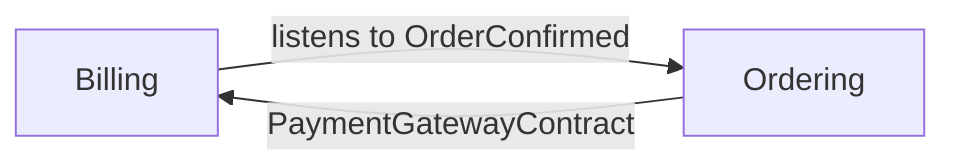

# Architecture

How the application is split into modules and how they talk to each other. Each module's own contract is in its `app/Domain/{Context}/README.md`; the reasons behind the structure are in [the ADRs](adr/README.md). The short version for agents is in `.ai/guidelines/20-project-contexts.md`.

## Modules

| Module | Owns | README |
| --- | --- | --- |
| `Example` | What this module is responsible for | [app/Domain/Example](../app/Domain/Example/README.md) |

## How modules talk

Arrows point from the module that depends to the module it depends on: an event a module listens to, or a contract it defines and another module implements.

## Shared kernel

What lives in `app/Domain/Shared` and why it is shared.

## External services

| Service | Used by | Behind contract |
| --- | --- | --- |
| Payment provider | `Billing` | `PaymentGatewayContract` |
